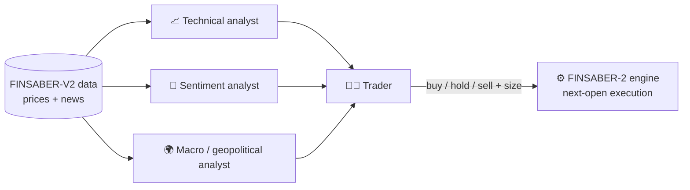

<div align="center">

# 🧪 Role Ablation in LLM Multi-Agent Trading Systems

**Does every specialist agent actually earn its place?**
A controlled ablation study of an LLM-based trading system, evaluated on the FINSABER-2 backtesting framework.


*Master's Thesis · M.Sc. in Artificial Intelligence · Universidad Alfonso X el Sabio (2026)*

</div>

---

## 🎯 What is this?

Multi-agent LLM systems for trading (analysts + a trader, mimicking an investment firm) are usually evaluated **as a whole**. Rarely is the contribution of each role isolated.

This project asks a simple, falsifiable question:

> **What is the marginal contribution of each specialist role (technical, sentiment, macro/geopolitical) to the performance of an LLM multi-agent trading system?**

To answer it, I built a 4-role system inspired by [TradingAgents](https://arxiv.org/abs/2412.20138), removed one analyst at a time, and backtested every variant under identical, bias-aware conditions.

## 🧩 System design



- Analysts return **structured JSON** (`signal`, `score`, `confidence`, `rationale`).
- The trader **reasons over the reports** (no mechanical averaging) and sizes the position; sizing is translated to orders in plain Python, never by the LLM.
- Strict no-outside-knowledge guardrails in every prompt to limit look-ahead leakage.

## 🔬 Experimental design

| | |
|---|---|
| **Configurations** | `full_system` · `no_technical` · `no_sentiment` · `no_fundamental` · `baseline_price_only` (trader only) |
| **Assets** | NVDA (high-vol tech) · JNJ (defensive) · XOM (energy / geopolitics) · JPM (financials / rates) |
| **Window** | Aug 2024 → Jan 2025 (126 sessions): after the model's training cutoff, includes the US election |
| **Runs** | 5 configs × 4 tickers = **20 backtests**, plus a buy-and-hold benchmark |
| **Metrics** | Total / annualized return, Sharpe, Calmar, max drawdown, number of trades, LLM cost |
| **Execution** | Signal at close, fill at next open; commissions modeled; independent capital per ticker |

## 🛠️ Engineering highlights

- 🔁 **Crash-safe runs**: day-level replay recovery from logs, with no repeated LLM calls and no partial-day contamination between configurations.
- 🧾 **Full traceability**: every LLM call (tokens, cost) and every agent output per day is logged for auditing and qualitative analysis.
- 🐞 **Framework hardening**: found, root-caused and worked around several incompatibilities in `finsaber==2.0.1` (cost accounting with the Responses API, a blocking plot, metric windows diluted by warm-up data), all documented.
- 🧮 **Causal technical indicators** implemented in pure pandas (SMA, RSI, MACD, Bollinger, ATR).
- ✅ **Unit tests** with mocked LLM calls for agents and orchestrator.
- 💸 **Cost-aware**: the entire experiment (7,056 LLM calls) cost about **$3.5**.

## 📊 Preliminary results

Average over 4 tickers, Aug 2024 → Jan 2025 (single run per configuration):

| Configuration | Total return | Max drawdown | Trades (avg) | LLM cost (avg) |
|---|---:|---:|---:|---:|
| `full_system` | −0.59 % | 6.07 % | 12.8 | $0.275 |
| `no_technical` | +0.60 % | 6.67 % | 10.8 | $0.226 |
| `no_sentiment` | −2.11 % | 4.92 % | 9.8 | $0.180 |
| `no_fundamental` | +0.68 % | 4.88 % | 12.5 | $0.176 |
| `baseline_price_only` | 0.00 % | 0.00 % | 0 | $0.029 |
| *Buy-and-hold (benchmark)* | *+9.34 %* | *14.90 %* | *2* | *$0* |

> ⚠️ **Read with care.** One run, four assets, six months, one market regime: differences between configurations are descriptive and not statistically established. The full analysis lives in the thesis.

## 🗂️ Repository structure

```
├── agents/          # technical, sentiment, fundamental & trader agents
├── llm/             # LLM wrapper: retries, structured output, cost logging
├── strategy/        # orchestrator + FINSABER-2 strategy interface
├── config/          # ablation.yaml (the 5 configurations)
├── prototypes/      # per-role prompt prototypes
├── tests/           # pytest suite (LLM mocked)
├── analysis/        # consolidated results, tables and figures
├── run_backtest.py  # one backtest with failure recovery
├── run_all.py       # launches the 20 backtests
├── run_buyhold.py   # buy-and-hold benchmark
└── consolidate_results.py   # metrics, deltas vs. full system, figures
```

## 🚀 Reproduce

```bash
# 1. Environment
python -m venv .venv && .venv\Scripts\activate
pip install -r requirements.txt

# 2. Data (≈7.5 GB, Hugging Face)
python -c "from huggingface_hub import snapshot_download; snapshot_download('waylonli/FINSABER-V2-Data', repo_type='dataset', local_dir='C:/finsaber-data')"

# 3. Configure .env (see variables below), then run
python run_all.py --dry-run          # preview the plan
python run_all.py                    # 20 backtests
python run_buyhold.py                # benchmark
python consolidate_results.py --results C:\finsaber-data\results --out analysis\consolidated

# Tests
pytest
```

`.env` variables: `AZURE_OPENAI_KEY`, `AZURE_OPENAI_ENDPOINT`, `FINSABER_DATA_PATH`, `FINSABER_RESULTS_PATH` (optional: `GEMINI_API_KEY`, used only for cross-provider prompt-format validation).

Raw results are written outside the repo (`FINSABER_RESULTS_PATH`); only the consolidated tables and figures are versioned in `analysis/consolidated/`.

## 🧰 Tech stack

Python · pandas · OpenAI SDK (Azure AI Foundry, Responses API) · FINSABER-2 · PyYAML · pytest · Hugging Face Hub · Git

## ⚖️ Scope and limitations

Single run per configuration (LLM non-determinism not averaged), 4 assets, 6 months, a cost-efficient model, and news indexed per company (shared by the sentiment and macro roles). Natural next steps: more seeds, assets and windows, relevance-aware news windows and an independent macro feed.

## 📚 Key references

- Xiao et al. (2024). *TradingAgents: Multi-Agents LLM Financial Trading Framework.*
- Li et al. (2026). *Can LLM-based financial investing strategies outperform the market in the long run?* (FINSABER, KDD '26)
- Yu et al. (2024). *FinCon: A Synthesized LLM Multi-Agent System…* (NeurIPS 2024)
- Yan et al. (2026). *TradeTrap: Are LLM-based Trading Agents Truly Reliable and Faithful?*

## 👤 Author

**Pablo Prol Prieto** · Master's in Artificial Intelligence, UAX
Supervisor: Dr. Juan Agustín Fraile Nieto

[GitHub](https://github.com/matowastaken) · [LinkedIn](https://www.linkedin.com/in/pablo-prol-prieto) · [Email](mailto:pabloprolprieto.ppp@gmail.com)

---

<sub>Academic research project. Nothing here is financial advice.</sub>