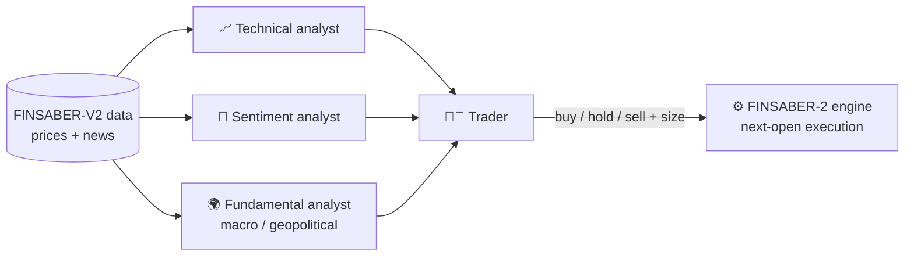

<div align="center">

# 🧪 Role Ablation in LLM Multi-Agent Trading Systems

**Does every specialist agent actually earn its place?**
A controlled ablation study of an LLM-based trading system, evaluated on the FINSABER-2 backtesting framework.


*Master's Thesis · M.Sc. in Artificial Intelligence · Universidad Alfonso X el Sabio (2026)*

</div>

---

## 🎯 What is this?

This repository contains the code, configuration and consolidated results of the Master's thesis **"Análisis de contribución por componente en sistemas de trading multiagente basados en LLMs"** (*Component-contribution analysis in LLM-based multi-agent trading systems*).

Multi-agent LLM systems for trading (analysts + a trader, mimicking an investment firm) are usually evaluated **as a whole**. Rarely is the contribution of each role isolated. This project asks a simple, falsifiable question:

> **What is the marginal contribution of each specialist role (technical, sentiment, fundamental/macro-geopolitical) to the performance of an LLM multi-agent trading system?**

To answer it, I built a 4-role system inspired by [TradingAgents](https://arxiv.org/abs/2412.20138), removed one analyst at a time, and backtested every variant under identical, bias-aware conditions. The experiment was run **three times** to estimate run-to-run variability, which turned out to be the key to reading the results.

## 🧩 System design



- Analysts return **structured JSON** (`signal`, `score`, `confidence`, `rationale`).
- The trader **reasons over the reports** (no mechanical averaging) and sizes the position; sizing is translated to orders in plain Python, never by the LLM.
- Strict no-outside-knowledge guardrails in every prompt to limit look-ahead leakage.
- The full prompts are reproduced in Annex A of the thesis and in `agents/`.

## 🔬 Experimental design

| | |
|---|---|
| **Configurations** | `full_system` · `no_technical` · `no_sentiment` · `no_fundamental` · `baseline_price_only` (trader only) |
| **Assets** | NVDA (high-vol tech) · JNJ (defensive) · XOM (energy / geopolitics) · JPM (financials / rates) |
| **Window** | Aug 2024 → Jan 2025 (126 sessions): after the model's training cutoff, includes the US election |
| **Runs** | 3 runs → **52 backtests** (20 in the first run, 16 in each replica), **48 of them comparable**, plus a buy-and-hold benchmark |
| **Metrics** | Total / annualized return, Sharpe, Calmar, max drawdown, number of trades, LLM cost |
| **Execution** | Signal at close, fill at next open; commissions modeled; independent capital per ticker |
| **Model** | `gpt-4.1-mini` (Azure AI Foundry, Responses API), temperature 0.2 |

The baseline (trader only) always holds cash, so it was run only once.

## 📊 Results

Mean over 4 tickers per run; value ± standard deviation across the 3 runs. Buy-and-hold is deterministic.

| Configuration | Total return (%) | Sharpe | Max drawdown (%) | Trades per asset | LLM cost (USD, 4 assets) |
|---|---:|---:|---:|---:|---:|
| `full_system` | −0.58 ± 0.42 | −0.34 ± 0.28 | 5.82 ± 0.28 | 12.1 ± 0.8 | 1.101 |
| `no_technical` | 0.05 ± 1.94 | −0.27 ± 0.41 | 7.02 ± 0.51 | 11.0 ± 0.2 | 0.904 |
| `no_sentiment` | −1.31 ± 1.09 | −1.25 ± 0.71 | 5.20 ± 1.01 | 10.6 ± 0.8 | 0.718 |
| `no_fundamental` | −0.88 ± 1.47 | −0.72 ± 0.36 | 5.52 ± 0.57 | 13.0 ± 1.1 | 0.704 |
| *Buy-and-hold (benchmark)* | *9.34* | *0.38* | *14.90* | *2* | *0* |

**Marginal contribution of each role** (`full_system` minus the configuration without that role; mean of 3 runs; positive = the role helps; drawdown sign reversed):

| Role | Total return (pp) | Sharpe | Calmar | Drawdown reduction (pp) |
|---|---:|---:|---:|---:|
| Technical | −0.62 | −0.07 | +0.42 | +1.20 |
| Sentiment | +0.73 | +0.91 | +1.16 | −0.62 |
| Fundamental | +0.30 | +0.38 | +0.82 | −0.30 |

**Main findings**

- The marginal contribution of most roles is **of the same order as run-to-run variability** (pooled SD of a single configuration-asset cell: **2.37 pp**), so no firm claim can be made for the technical or fundamental role.
- No role met the pre-defined criterion for being harmful. Only the **sentiment** role met the criterion for a consistent contribution, with weak evidence (≈ 1.6 standard errors).
- Results are **strongly asset-dependent**: all three roles contributed negatively on NVDA.
- No configuration with analysts beat buy-and-hold on the two rising stocks (JPM, NVDA); all beat it on the two falling ones (JNJ, XOM). Their max drawdowns (5.20–7.02 %) were far below buy-and-hold (14.90 %), consistent with a trader that holds cash 91 % of days.
- A single run would have led to different conclusions (e.g. the fundamental role: −1.27 pp in the first run alone vs. +0.30 pp over three).

> ⚠️ **Read with care.** Four assets, six months, one market regime, one inexpensive model and three runs: the study is descriptive and no formal statistical tests are made. The full analysis, limitations and discussion are in the thesis.

## 🛠️ Engineering highlights

- 🔁 **Crash-safe runs**: day-level replay recovery from logs, with no repeated LLM calls and no partial-day contamination between configurations.
- 🧾 **Full traceability**: every LLM call (tokens, cost) and every agent output per day is logged for auditing and qualitative analysis.
- 🐞 **Framework hardening**: found, root-caused and worked around several incompatibilities in `finsaber==2.0.1` (cost accounting with the Responses API, a blocking equity plot, a broken final aggregation step, metric windows diluted by warm-up data), all documented.
- 🧮 **Causal technical indicators** implemented in pure pandas (SMA, RSI, MACD, Bollinger, ATR).
- ✅ **Unit tests** with mocked LLM calls for agents and orchestrator.
- 💸 **Cost-aware**: ~20,000 LLM calls across the three runs for about **$10.4** in total (the first run alone, 7,056 calls, cost $3.54).

## 🗂️ Repository structure

```
├── agents/          # technical, sentiment, fundamental & trader agents
├── llm/             # LLM wrapper: retries, structured output, cost logging
├── strategy/        # orchestrator + FINSABER-2 strategy interface
├── config/          # ablation.yaml (the 5 configurations)
├── prototypes/      # per-role prompt prototypes
├── tests/           # pytest suite (LLM mocked)
├── analysis/        # consolidated results, tables and figures (3 runs)
├── run_backtest.py  # one backtest with failure recovery
├── run_all.py       # launches the backtests of a run
├── run_buyhold.py   # buy-and-hold benchmark
├── consolidate_results.py   # metrics, deltas vs. full system, figures
└── analysis_5_*.py  # scripts behind the thesis analysis (Chapter 5)
```

## 🚀 Reproduce

Requires Python 3.14 and `finsaber==2.0.1` (pinned in `requirements.txt`).

```bash
# 1. Environment
python -m venv .venv && .venv\Scripts\activate
pip install -r requirements.txt

# 2. Data (≈7.5 GB, Hugging Face): not included in this repo
python -c "from huggingface_hub import snapshot_download; snapshot_download('waylonli/FINSABER-V2-Data', repo_type='dataset', local_dir='C:/finsaber-data')"

# 3. Configure .env (see variables below), then run
python run_all.py --dry-run          # preview the plan
python run_all.py                    # 20 backtests (first run)
python run_buyhold.py                # benchmark
python consolidate_results.py --results C:\finsaber-data\results --out analysis\consolidated

# Tests
pytest
```

`.env` variables: `AZURE_OPENAI_KEY`, `AZURE_OPENAI_ENDPOINT`, `FINSABER_DATA_PATH`, `FINSABER_RESULTS_PATH` (optional: `GEMINI_API_KEY`, used only for cross-provider prompt-format validation). Copy `.env.example` and fill in your own values; no credentials are included in the repo.

To reproduce the replicas, run the four configurations with analysts again, using a different `FINSABER_RESULTS_PATH` for each run, and consolidate each folder with `consolidate_results.py` (options `--setups` and `--label`).

**On reproducibility.** The LLM is not deterministic, so a new run will **not** reproduce the thesis figures to the decimal, but values within the variability reported above. The consolidated results of the three runs used in the thesis are versioned in `analysis/`. Raw backtest outputs are written outside the repo (`FINSABER_RESULTS_PATH`) and are not versioned.

## 🧰 Tech stack

Python · pandas · OpenAI SDK (Azure AI Foundry, Responses API) · FINSABER-2 · PyYAML · pytest · Hugging Face Hub · Git

## ⚖️ Scope and limitations

Three runs per configuration (standard deviations are rough estimates), 4 hand-picked assets that exist today (no survivorship control), 6 months in a single market regime, a cost-efficient model, a simplified architecture (no bull/bear debate or risk team), a trader that only knows whether it holds shares or not, and news indexed per company and shared by the sentiment and fundamental roles (their scores correlate at r = 0.79).

Natural next steps: more runs, assets and windows; a separate macro news feed and own sources for each analyst; relevance-aware news windows and de-duplication; varying the coordination protocol instead of the roles.

## 🤖 Use of AI assistance

The code was developed with Claude following a spec-driven method: each component (prompts, output formats, interfaces, configurations, evaluation protocol) was specified first, and the generated code was verified by me, by the automated tests and by runs on the real backtesting framework.

## 📚 Key references

- Xiao et al. (2024). *TradingAgents: Multi-Agents LLM Financial Trading Framework.*
- Li et al. (2026). *Can LLM-based financial investing strategies outperform the market in long run?* (FINSABER, KDD '26)
- Nguyen & Pham (2026). *Toward Reliable Evaluation of LLM-Based Financial Multi-Agent Systems.*
- Yu et al. (2024). *FinCon: A Synthesized LLM Multi-Agent System…* (NeurIPS 2024)
- Yan et al. (2025). *TradeTrap: Are LLM-based Trading Agents Truly Reliable and Faithful?*

## 📝 How to cite

> Prol Prieto, P. (2026). *Ablación por rol de un sistema multiagente LLM de trading: código del TFM* [Software]. https://github.com/matowastaken/TFM

## 👤 Author

**Pablo Prol Prieto** · Master's in Artificial Intelligence, UAX
Supervisor: Dr. Juan Agustín Fraile Nieto

[GitHub](https://github.com/matowastaken) · [LinkedIn](https://www.linkedin.com/in/pablo-prol-prieto) · [Email](mailto:pabloprolprieto.ppp@gmail.com)

---

<sub>Academic research project. Nothing here is financial advice.</sub>